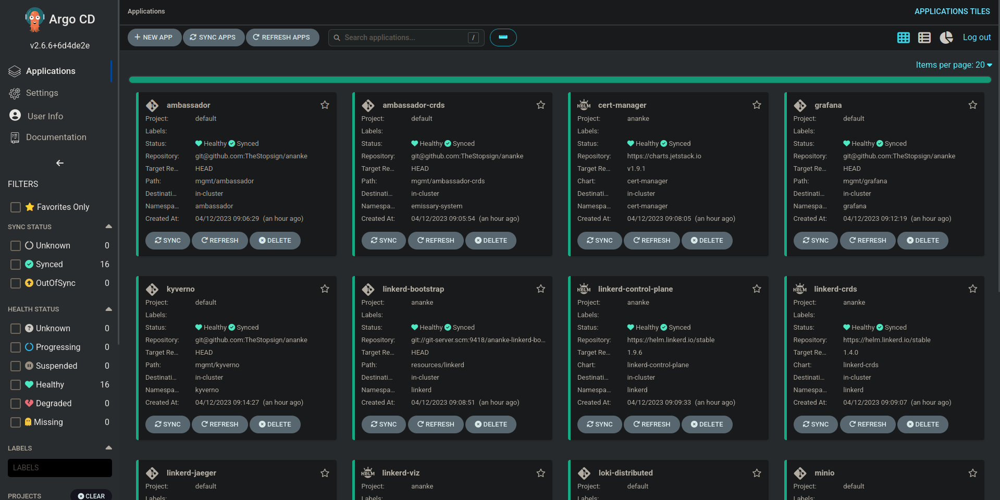
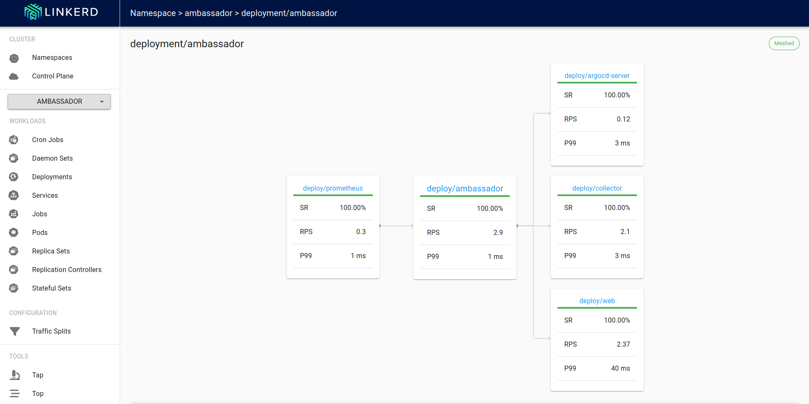
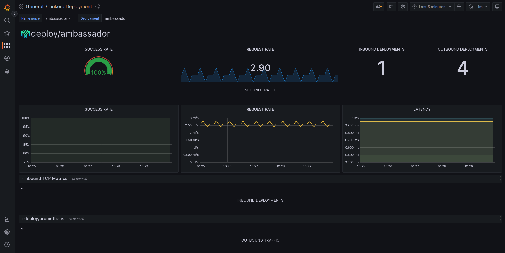
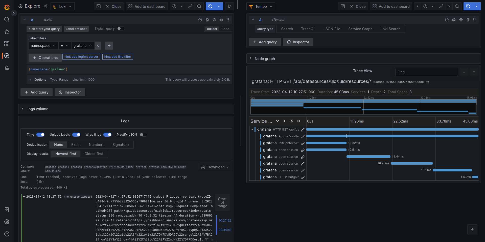

# ananke

Everything is necessary

# Breakdown

## ArgoCD

CI/CD | GitOps

## Linkerd

Service Mesh | Load Balancing | Traffic Splits | Multicluster | Failovers

## Grafana

Observability | Dashboards | Logs | Metrics | Traces

    
    

